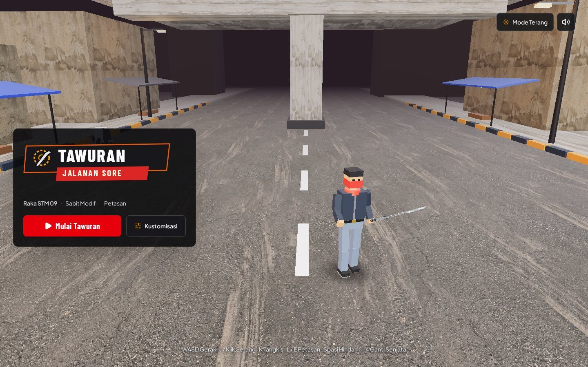
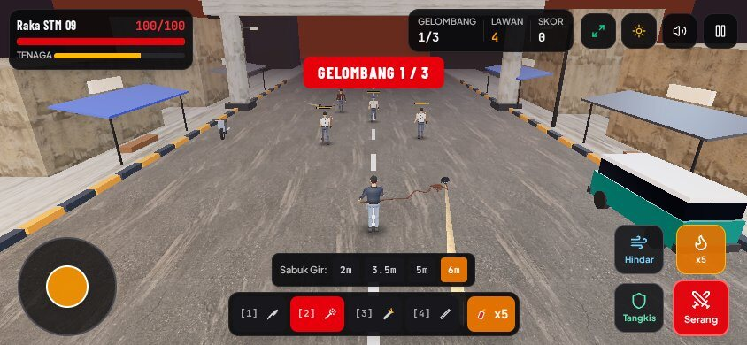

# remaja-ertiga-management-system

Sistem manajemen organisasi Remaja Ertiga — anggota, iuran, keuangan, kegiatan, laporan.
PHP + Google Sheets + Google Drive.

## 📱 APK Android (aplikasi mobile)

Aplikasi Android dibangun dari proyek web di `apps/tawuran/` (React + Vite +
Three.js) dan dibungkus dengan Capacitor.

**Unduh & pasang langsung di HP:**

```
https://github.com/lrosidid25-stack/remaja-ertiga-management-system/releases/download/apk-terbaru/tawuran-jalanan-sore.apk
```

|  |  |
| --- | --- |
| Layar judul + pemilih peta | Gelombang 1/3 · sabuk gir 6 m |

### 🗺️ 10 peta jalanan + sistem level

Pilih peta di layar judul (geser ke samping). Peta berikutnya terbuka otomatis
setelah peta sebelumnya ditamatkan; kemajuan disimpan di HP (offline).

| # | Peta | Lebar jalan | Kesulitan |
| --- | --- | --- | --- |
| 1 | Jalanan Sore | 24 m | 1 |
| 2 | Gang Sempit | 19 m | 2 |
| 3 | Pasar Malam | 26 m | 3 |
| 4 | Kolong Flyover | 22 m | 4 |
| 5 | Terminal Angkot | 28 m | 5 |
| 6 | Bantaran Sungai | 30 m | 6 |
| 7 | Perumahan Kosong | 24 m | 7 |
| 8 | Underpass Layang | 20 m | 8 |
| 9 | Alun-alun Malam | 28 m | 9 |
| 10 | Markas Lawan | 26 m | 10 |

Tiap peta punya jumlah gelombang, HP & kecepatan lawan, jumlah teman satu
geng, serta bos `pentolan` di gelombang terakhir yang berbeda-beda.

### 🧍 Karakter modular (Blender → GLB → three.js)

Model pemain bisa diganti di **Kustomisasi → Model Karakter 3D**:

- **Prosedural (bawaan)** — rig kode (`src/game/models.ts`), selalu tersedia.
- **GLB Modular** — `public/characters/base_humanoid.glb`: skeleton humanoid
  21 tulang + 6 socket aksesori (rambut, topi, kacamata, masker, tas, jaket).
  Kalau asetnya hilang/rusak, game otomatis kembali ke prosedural.

Aset GLB dibuat ulang tanpa dependensi dengan `npm run build:glb` (otomatis
sebelum `npm run build`). Untuk bikin model sendiri di Blender:
`apps/tawuran/blender/modular_character.py` + panduan di
[apps/tawuran/blender/README.md](apps/tawuran/blender/README.md).

### 🎮 Mabar Online (duel 1 lawan 1)

Di layar judul ketuk tombol hijau **Mabar**:

1. Satu pemain jadi **tuan rumah** → dapat **kode 4 huruf** (contoh `AB3D`) → kirim ke teman lewat chat.
2. Teman buka Tawuran → **Mabar** → ketik kode → **Gabung**.
3. Duel langsung mulai di map pilihan tuan rumah. Nyawa lawan tampil di bar kuning bagian atas, skor kita di kanan.

Butuh internet **hanya saat mabar**; mode gelombang tetap jalan 100% offline.
Server mabar memakai Supabase Realtime (gratis). Workflow
`supabase-keepalive.yml` menembak proyeknya sekali sehari supaya tidak
di-pause otomatis karena tidak ada aktivitas.

APK dibuat otomatis oleh GitHub Actions setiap ada perubahan di `apps/tawuran/`
(lihat `.github/workflows/build-apk.yml`) dan dipublikasikan ke rilis
[`apk-terbaru`](../../releases/tag/apk-terbaru).

Panduan lengkap (pasang di HP, build sendiri, ganti ikon, ganti versi, tanda
tangan release): **[apps/tawuran/BUILD-APK.md](apps/tawuran/BUILD-APK.md)**

> Galeri tangkapan layar: [apps/tawuran/docs/SCREENSHOTS.md](apps/tawuran/docs/SCREENSHOTS.md)

## 🗂️ Struktur repo

| Path | Isi |
| --- | --- |
| `_app.php`, `pages/`, `includes/`, `config/` | Aplikasi web PHP (dipakai di Vercel + Supabase) |
| `apps/tawuran/` | Proyek aplikasi Android (web app + pembungkus Capacitor) |
| `.github/workflows/build-apk.yml` | Pipeline build APK → GitHub Releases |

## 🖥️ Aplikasi web PHP

Butuh PHP 8+ (lokal pakai SQLite, di Vercel pakai Supabase).
Banyak halaman di `pages/` belum dibuat — lihat daftar route di `_app.php`.
