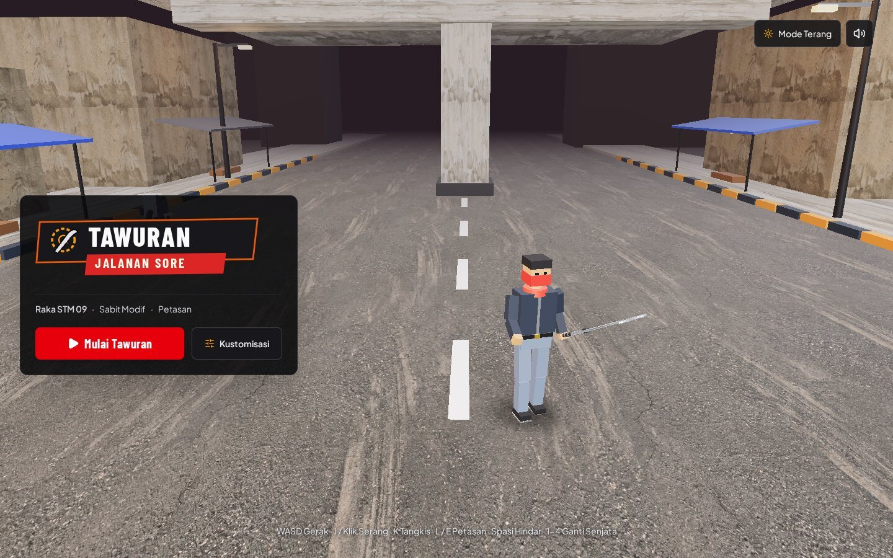
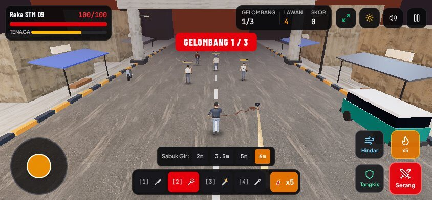

# Build APK — Tawuran: Jalanan Sore

Folder ini berisi proyek web (React + Vite + Three.js) yang dibungkus jadi
aplikasi Android memakai **Capacitor**, plus pipeline GitHub Actions yang
otomatis membuat file `.apk`.

```
apps/tawuran/
├── index.html, package.json, vite.config.ts   # proyek web (dari AI Studio)
├── src/                                        # kode game lengkap (dari AI Studio)
│   ├── game/                                   # engine, types, rules, models, audio, …
│   └── assets/images/                          # tekstur aspal & beton
├── assets/icon.png                             # ikon sumber 1024×1024
├── capacitor.config.ts                         # konfigurasi aplikasi Android
└── android/                                    # proyek Android (Gradle)
    ├── app/src/main/res/…                      # ikon + splash semua densitas
    └── gradlew                                 # build tanpa perlu Android Studio
```

| Item | Nilai |
| --- | --- |
| Package / applicationId | `id.remajaertiga.tawuran` |
| Nama aplikasi | Tawuran: Jalanan Sore |
| minSdk / targetSdk | 24 / 36 (jalan di Android 7 ke atas — itel RS4 = Android 14 ✅) |
| Arsitektur | universal (arm64-v8a, armeabi-v7a, x86_64) |
| Jaringan | **offline** — semua aset dibundel ke dalam APK |

---

## 0. Tangkapan layar

Lihat galeri lengkap: **[docs/SCREENSHOTS.md](docs/SCREENSHOTS.md)** — judul,
kustomisasi karakter, prolog 4 beat, pertarungan gir 2 m vs 6 m, dan tampilan HP.

|  |  |
| --- | --- |
| Layar judul | Gelombang 1/3 dengan gir 6 m |

## 1. Cara memasang APK di HP (itel RS4)

**Paling gampang:** scan QR ini dengan kamera HP (atau Google Lens), lalu buka
tautannya di browser.


Atau salin tautan ini ke browser HP:

```
https://github.com/lrosidid25-stack/remaja-ertiga-management-system/releases/download/apk-terbaru/tawuran-jalanan-sore.apk
```

1. Buka tautan rilis di browser HP:
   `https://github.com/lrosidid25-stack/remaja-ertiga-management-system/releases/download/apk-terbaru/tawuran-jalanan-sore.apk`
2. File `tawuran-jalanan-sore.apk` akan terunduh.
3. Buka file itu dari **notifikasi** atau dari **File Manager → Download**.
4. Android akan menolak sekali dan menawarkan **"Setelan"** → aktifkan
   **"Izinkan dari sumber ini"** (Install unknown apps) untuk browser/File Manager.
5. Tekan **Instal** → **Buka**.

> APK ditandatangani dengan **kunci tetap** yang disimpan di
> `android/keystore/tawuran-signing.p12`, jadi APK versi baru bisa dipasang
> **menimpa** versi lama tanpa uninstall. Kalau muncul "aplikasi tidak
> terpasang", kemungkinan versi di HP ditandatangani kunci lain → hapus dulu
> aplikasi lamanya.

---

## 2. Membuat APK di GitHub (tanpa install apa pun di komputer)

Workflow `.github/workflows/build-apk.yml` jalan otomatis setiap kali ada
perubahan di `apps/tawuran/`:

- **Tab Actions** → run "Build APK" → unduh artifact `tawuran-jalanan-sore-apk`.
- **Tab Releases** → tag `apk-terbaru` → link unduhan langsung untuk HP.

Memicu manual: tab **Actions** → **Build APK** → **Run workflow**.

---

## 3. Build di komputer sendiri

Prasyarat: Node.js 22+, JDK 21, Android SDK (paling mudah lewat Android Studio).

```bash
cd apps/tawuran
npm ci
npm run build            # hasil web → dist/
npx cap sync android     # salin dist/ ke proyek Android
cd android
./gradlew assembleRelease  # → app/build/outputs/apk/release/app-release.apk
```

Atau buka folder `apps/tawuran/android` langsung di Android Studio lalu
**Build → Build Bundle(s)/APK(s) → Build APK(s)**.

---

## 4. Status kode game

Seluruh kode game dari AI Studio sudah masuk — tidak ada file pengganti lagi.

| File | Keterangan |
| --- | --- |
| `src/main.tsx`, `src/App.tsx`, `src/index.css` | orkestrasi React |
| `src/components/*.tsx` (8 file) | TitleOverlay, IntroOverlay, CustomizerDrawer, GameHud, GameModal, RotatePrompt, SvgIcons, TouchControls |
| `src/game/engine.ts` (3.364 baris) | `BrawlEngine` — mesin Three.js |
| `src/game/types.ts`, `rules.ts`, `rules.test.ts` | tipe, statistik senjata, 9 unit test |
| `src/game/models.ts`, `environment.ts`, `flexibleGir.ts`, `audio.ts` | model karakter, lingkungan, sabuk gir fleksibel, audio |
| `src/assets/images/*.jpg` | tekstur aspal & beton (di-import lewat bundler) |

### Perintah harian

```bash
npm run check:src   # pastikan semua import relatif tersedia
npm run test        # 9 unit test rules.ts (node:test via tsx)
npm run lint        # tsc --noEmit
npm run build       # bundel web → dist/
npm run apk         # build + cap sync (butuh Android SDK lokal)
```

CI menjalankan urutan yang sama (check → test → lint → build → gradle →
`apksigner verify`) sebelum menerbitkan APK.

> **Gerbang CI:** kalau `check:src` gagal (ada modul hilang), build dilewati dan
> rilis `apk-terbaru` tidak disentuh, supaya APK yang sudah bisa dipasang tidak
> pernah rusak.

## 5. Regenerasi ikon & splash

Ikon adaptif lama sudah dihapus supaya PNG dipakai di semua versi Android.

```bash
cd apps/tawuran
R=android/app/src/main/res
for d in mdpi:48 hdpi:72 xhdpi:96 xxhdpi:144 xxxhdpi:192; do
  dens=${d%%:*}; px=${d##*:}
  convert assets/icon.png -resize ${px}x${px} "$R/mipmap-$dens/ic_launcher.png"
  convert assets/icon.png -resize ${px}x${px} \
    \( -size ${px}x${px} xc:none -fill white \
       -draw "circle $((px/2)),$((px/2)) $((px/2)),0" \) \
    -alpha off -compose CopyOpacity -composite "$R/mipmap-$dens/ic_launcher_round.png"
done
for f in $R/drawable/splash.png $R/drawable-port-*/splash.png $R/drawable-land-*/splash.png; do
  W=$(identify -format '%w' "$f"); H=$(identify -format '%h' "$f")
  MIN=$(( W < H ? W : H )); LOGO=$(( MIN * 42 / 100 ))
  convert -size ${W}x${H} xc:"#09090b" \
    \( assets/icon.png -resize ${LOGO}x${LOGO} \) -gravity center -composite "$f"
done
```

---

## 6. Ganti versi aplikasi

Edit `apps/tawuran/android/app/build.gradle`:

```gradle
versionCode 2          // harus naik setiap rilis
versionName "0.2.0"
```

---

## 7. Membuat APK release bertanda tangan (opsional)

Untuk distribusi jangka panjang, buat keystore sendiri (jangan commit ke repo):

```bash
keytool -genkey -v -keystore tawuran-release.jks -keyalg RSA \
  -keysize 2048 -validity 10000 -alias tawuran
```

Lalu tambahkan `signingConfigs` di `android/app/build.gradle` dan simpan
password-nya sebagai **GitHub Actions secrets** (`KEYSTORE_BASE64`,
`KEYSTORE_PASSWORD`, `KEY_ALIAS`, `KEY_PASSWORD`).
