# Tangkapan layar — Tawuran: Jalanan Sore

Diambil dari build web (AI Studio). APK berisi bundel yang sama — teks UI
`JALANAN SORE`, `GELOMBANG`, `Kustomisasi Karakter`, `Lewati Intro`, dan
`Sabuk Gir` terverifikasi ada di dalam berkas APK yang dirilis.

## Judul & kustomisasi

| Judul | Kustomisasi (Jaket Bomber) |
| --- | --- |
| 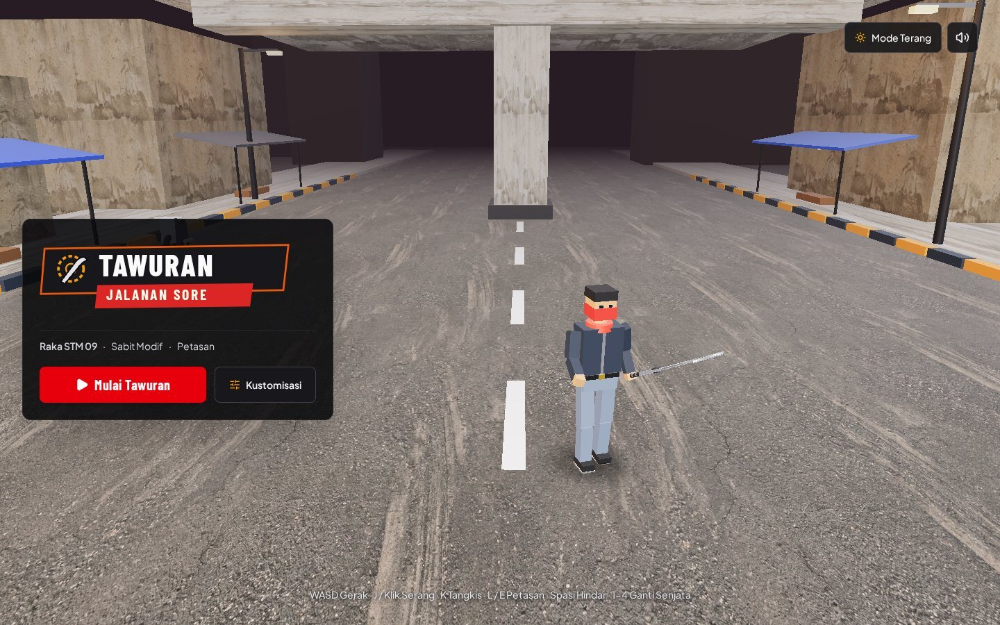 | 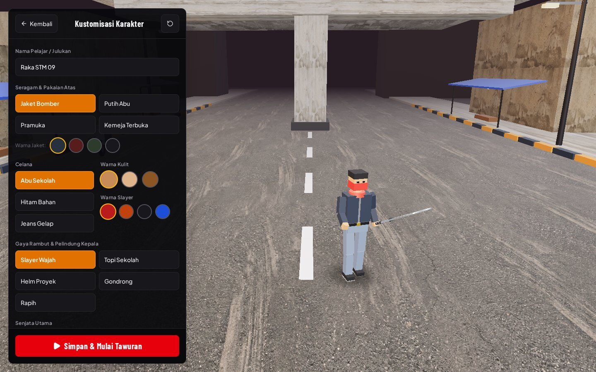 |

| Kustomisasi (Putih Abu + Helm Proyek) | Kustomisasi — Sabuk Gir 6 m |
| --- | --- |
| 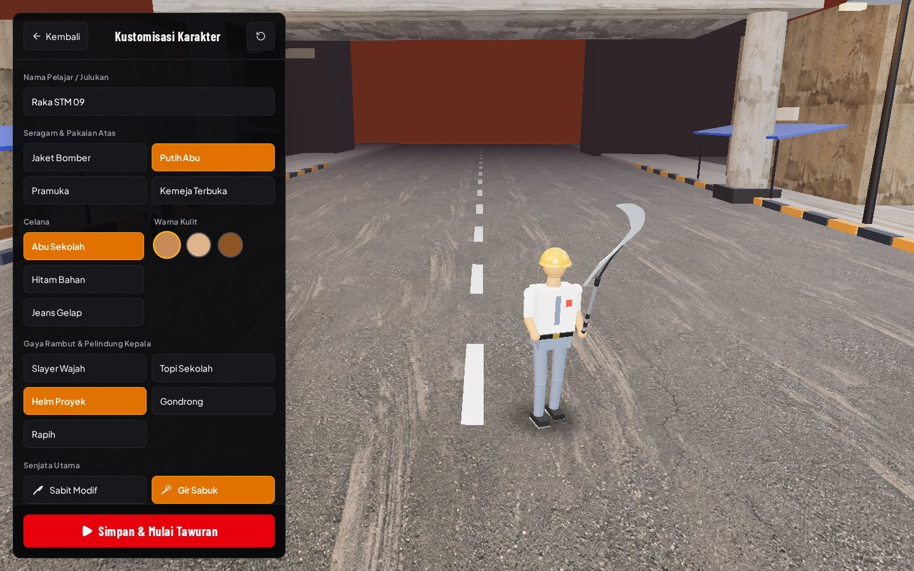 | 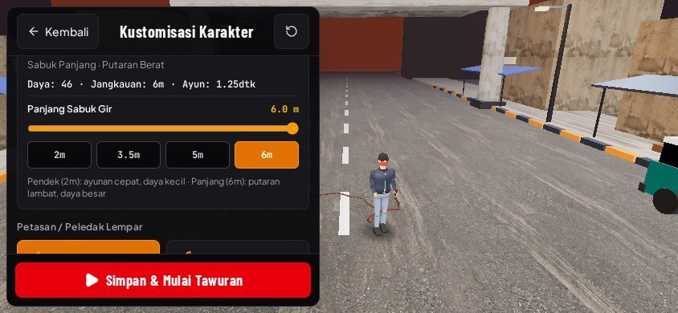 |

Sabuk gir punya empat preset (2 m · 3,5 m · 5 m · 6 m). Semakin panjang →
jangkauan dan daya naik, tapi putaran makin lambat (6 m: daya 46, ayun 1,25 dtk).

## Prolog (4 beat)

| 1/4 — Ajakan | 2/4 — Provokasi |
| --- | --- |
| 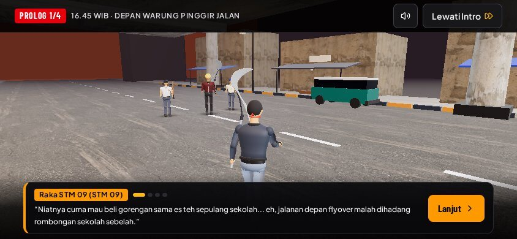 | 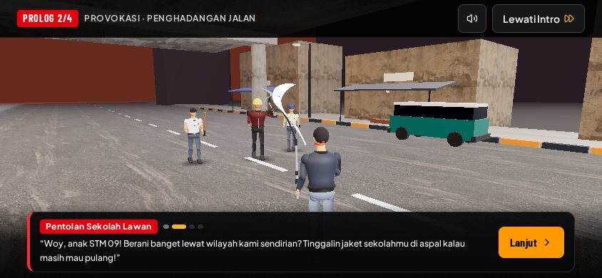 |

| 3/4 — Petasan peringatan | 4/4 — Siap tempur |
| --- | --- |
| 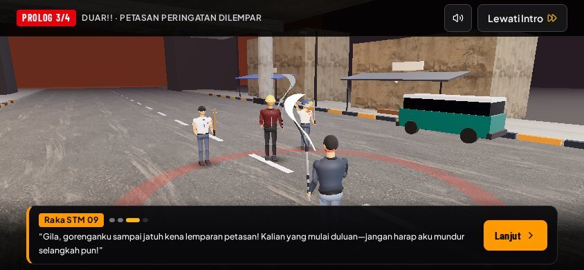 | 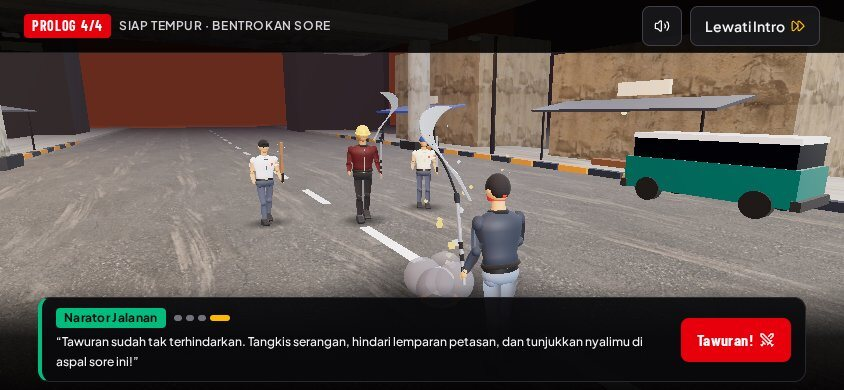 |

## Pertarungan

| Gir 2 m — jangkauan pendek | Gir 6 m — jangkauan panjang |
| --- | --- |
| 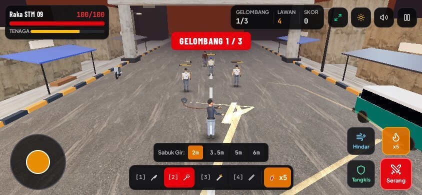 | 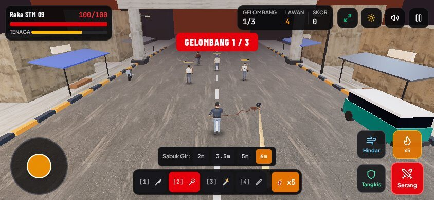 |

| Ayunan gir 6 m (busur panjang) | Tampilan HP (portrait) |
| --- | --- |
| 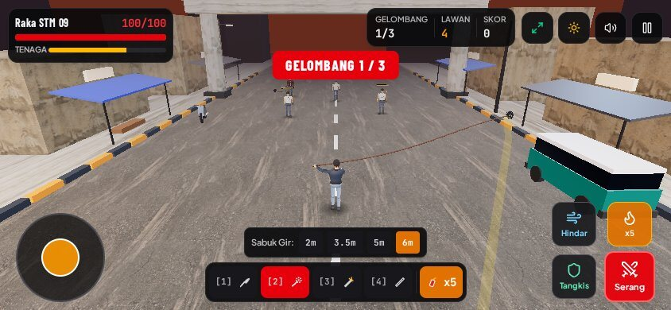 | 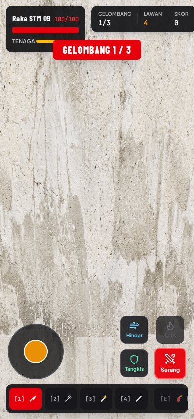 |

## Catatan: kamera menembus tiang

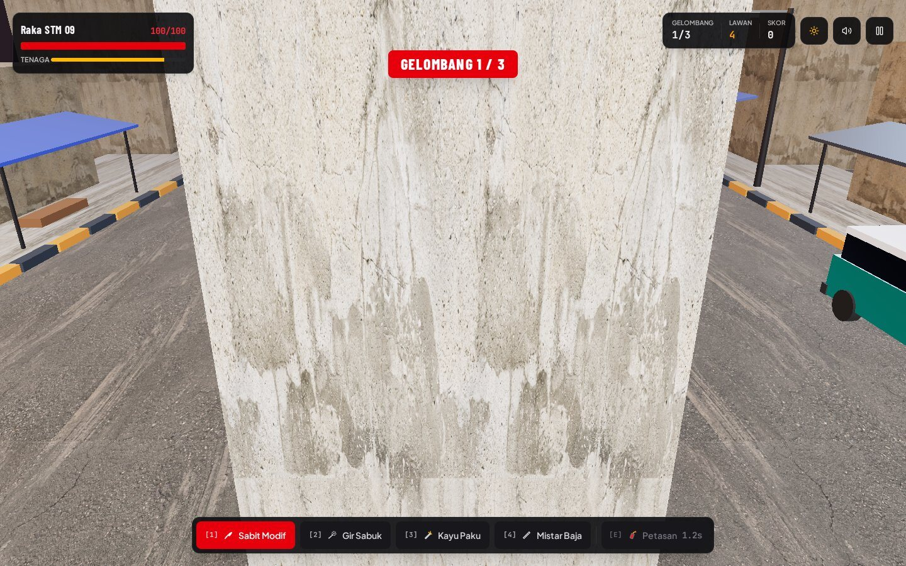

Pada frame ini kamera masuk ke dalam tiang beton sehingga layar tertutup
tekstur dinding. `engine.ts` belum memakai `THREE.Raycaster` untuk menahan
kamera di depan penghalang — kalau mau diperbaiki, tambahkan raycast dari
pemain ke posisi kamera lalu dorong kamera ke titik tumbukan.

---

Semua gambar di folder ini sudah dikompres (1,9 MB total, dari 3,9 MB asli)
dan tidak ikut dibundel ke dalam APK — hanya untuk dokumentasi repo.
